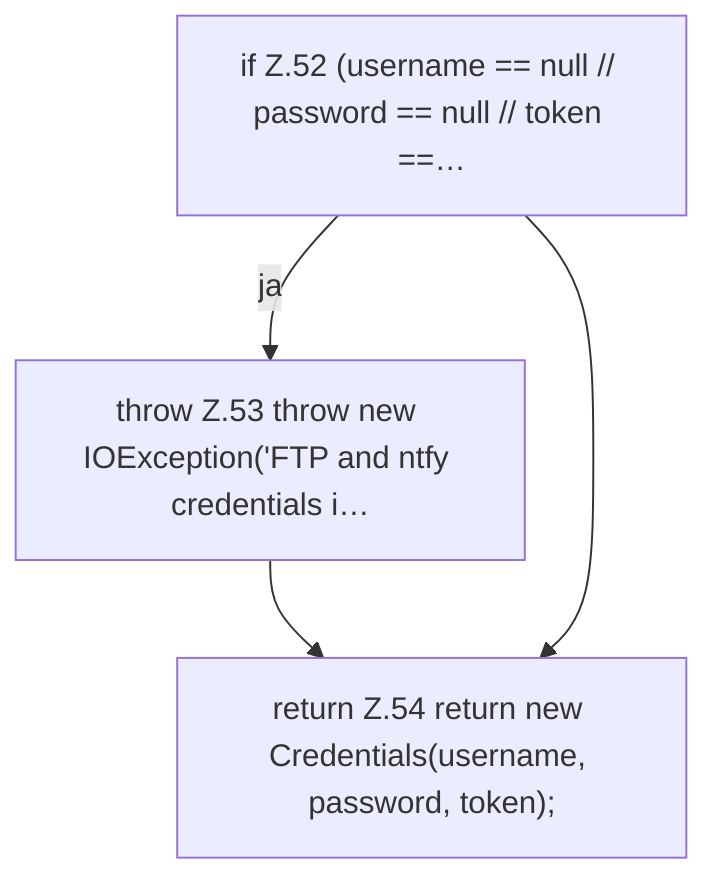

[[00 Start]] › [[Backup]] › [[Backup-Bruecken]] › [[BackupSecrets]] › [[BackupSecrets.load]] › [[BackupSecrets.load.Teil2]]

# BackupSecrets.load.Teil2

- Fortsetzung von `BackupSecrets.load`, Quellreihenfolge.
