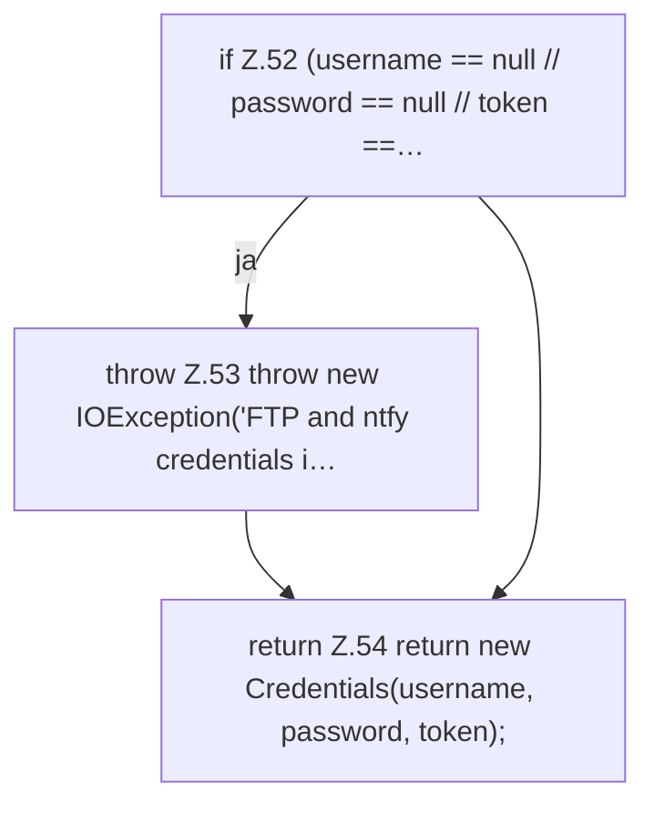

[[00 Start]] › [[Backup]] › [[Backup-Bruecken]] › [[BackupSecrets]] › [[BackupSecrets.load]] › [[BackupSecrets.load.Teil2]]

# BackupSecrets.load.Teil2



```knoten
if Z.52 (username == null // password == null // token ==…
  Zeile 52: prüft `(username == null // password == null // token ==…`.
throw Z.53 throw new IOException('FTP and ntfy credentials i…
  Zeile 53: Abbruch `throw new IOException('FTP and ntfy credentials i…`.
return Z.54 return new Credentials(username, password, token);
  Zeile 54: Rückgabe `return new Credentials(username, password, token);`.
```

> [!knoten]- Was die Blöcke tun
> - **if Z.52 (username == null // password == null // token ==…**: Zeile 52: prüft `(username == null // password == null // token ==…`.
> - **throw Z.53 throw new IOException('FTP and ntfy credentials i…**: Zeile 53: Abbruch `throw new IOException('FTP and ntfy credentials i…`.
> - **return Z.54 return new Credentials(username, password, token);**: Zeile 54: Rückgabe `return new Credentials(username, password, token);`.

- Ein weiterer Abschnitt derselben Übersicht.
- Fortsetzung von `BackupSecrets.load`.
