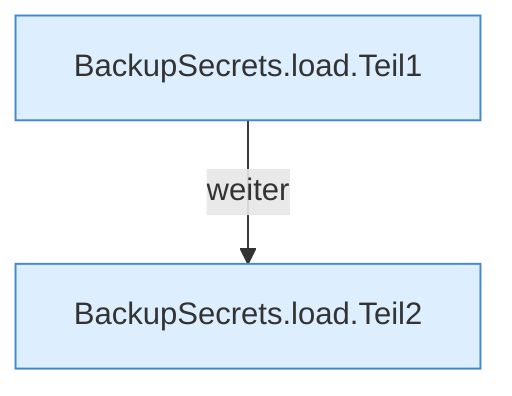

[[00 Start]] › [[Backup]] › [[Backup-Bruecken]] › [[BackupSecrets]] › [[BackupSecrets.load]]

# BackupSecrets.load

`BackupSecrets.load(Path pluginDirectory)` [src/main/java/de/aichele/childlauncher/BackupSecrets.java:26–55](https://github.com/Sciddie/minecraft-serverhoster-plugin/blob/95b02b953b0b4c23673e900e021a7c3c844aa37d/src/main/java/de/aichele/childlauncher/BackupSecrets.java#L26-L55)



```knoten
BackupSecrets.load.Teil1
  Abschnitt 1 dieses Ablaufs, in Quellreihenfolge.
BackupSecrets.load.Teil2
  Abschnitt 2 dieses Ablaufs, in Quellreihenfolge.
```

- `load` in `src/main/java/de/aichele/childlauncher/BackupSecrets.java`
