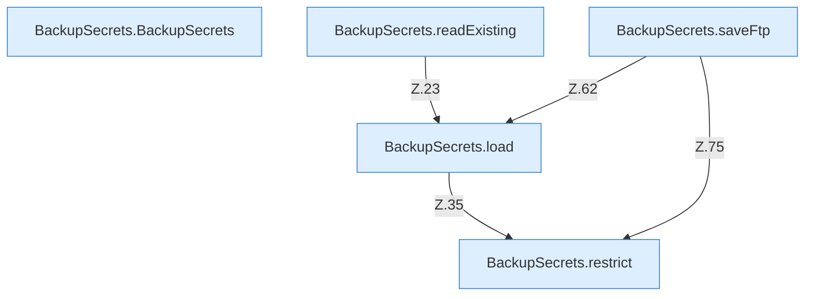

[[00 Start]] › [[Backup]] › [[Backup-Bruecken]] › [[BackupSecrets]]

# BackupSecrets



```knoten
BackupSecrets.BackupSecrets
  Dieser Teil sichert die Zugangsdaten. Im [[Glossar#Quelltext|Quelltext]] heißt das `BackupSecrets`.
BackupSecrets.readExisting
  Dieser Teil liest hier einen Schritt. Eine Ebene tiefer steht er genauer. Im [[Glossar#Quelltext|Quelltext]] heißt das `readExisting`.
BackupSecrets.load
  Dieser Teil lädt das. Im [[Glossar#Quelltext|Quelltext]] heißt das `load`.
BackupSecrets.saveFtp
  Dieser Teil speichert die Übertragung. Im [[Glossar#Quelltext|Quelltext]] heißt das `saveFtp`.
BackupSecrets.restrict
  Dieser Teil macht hier einen einzelnen Schritt. Eine Ebene tiefer steht er genauer. Im [[Glossar#Quelltext|Quelltext]] heißt das `restrict`.
```

> [!knoten]- Was die Blöcke tun
> - **BackupSecrets.BackupSecrets**: Dieser Teil sichert die Zugangsdaten. Im [[Glossar#Quelltext|Quelltext]] heißt das `BackupSecrets`.
> - **BackupSecrets.readExisting**: Dieser Teil liest hier einen Schritt. Eine Ebene tiefer steht er genauer. Im [[Glossar#Quelltext|Quelltext]] heißt das `readExisting`.
> - **BackupSecrets.load**: Dieser Teil lädt das. Im [[Glossar#Quelltext|Quelltext]] heißt das `load`.
> - **BackupSecrets.saveFtp**: Dieser Teil speichert die Übertragung. Im [[Glossar#Quelltext|Quelltext]] heißt das `saveFtp`.
> - **BackupSecrets.restrict**: Dieser Teil macht hier einen einzelnen Schritt. Eine Ebene tiefer steht er genauer. Im [[Glossar#Quelltext|Quelltext]] heißt das `restrict`.

- Die Zugangsdaten für die [[Glossar#Sicherungskopie|Sicherungskopie]] auf einem anderen Rechner.
