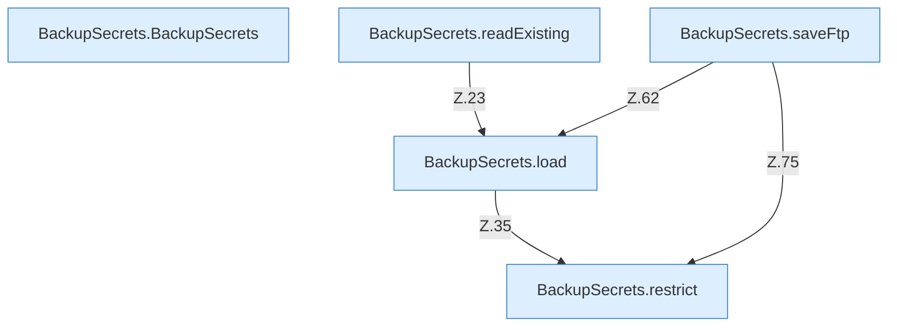

[[00 Start]] › [[Backup]] › [[Backup-Bruecken]] › [[BackupSecrets]]

# BackupSecrets



```knoten
BackupSecrets.BackupSecrets
  Sichert `BackupSecrets`.
BackupSecrets.readExisting
  Liest `readExisting`. Ruft `load`.
BackupSecrets.load
  Lädt `load`. Ruft `restrict`.
BackupSecrets.saveFtp
  Speichert `saveFtp`. Ruft `load`, `restrict`.
BackupSecrets.restrict
  `restrict` in `BackupSecrets.java`.
```


