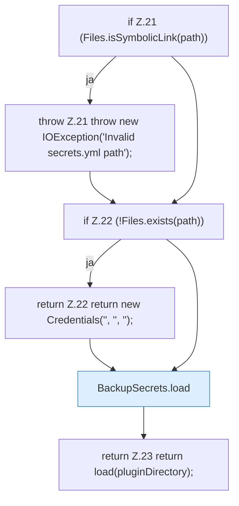

[[00 Start]] › [[Backup]] › [[Backup-Bruecken]] › [[BackupSecrets]] › [[BackupSecrets.readExisting]]

# BackupSecrets.readExisting

`BackupSecrets.readExisting(Path pluginDirectory)` [src/main/java/de/aichele/childlauncher/BackupSecrets.java:19–24](https://github.com/Sciddie/minecraft-serverhoster-plugin/blob/95b02b953b0b4c23673e900e021a7c3c844aa37d/src/main/java/de/aichele/childlauncher/BackupSecrets.java#L19-L24)

- `readExisting` in `src/main/java/de/aichele/childlauncher/BackupSecrets.java`
