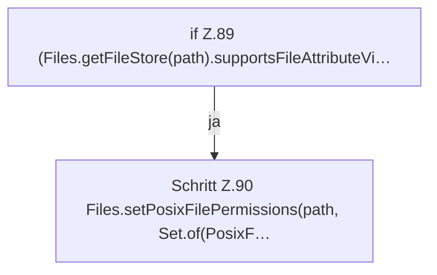

[[00 Start]] › [[Backup]] › [[Backup-Bruecken]] › [[BackupSecrets]] › [[BackupSecrets.restrict]]

# BackupSecrets.restrict

`BackupSecrets.restrict(Path path)` [src/main/java/de/aichele/childlauncher/BackupSecrets.java:88–92](https://github.com/Sciddie/minecraft-serverhoster-plugin/blob/95b02b953b0b4c23673e900e021a7c3c844aa37d/src/main/java/de/aichele/childlauncher/BackupSecrets.java#L88-L92)

- `restrict` in `src/main/java/de/aichele/childlauncher/BackupSecrets.java`
