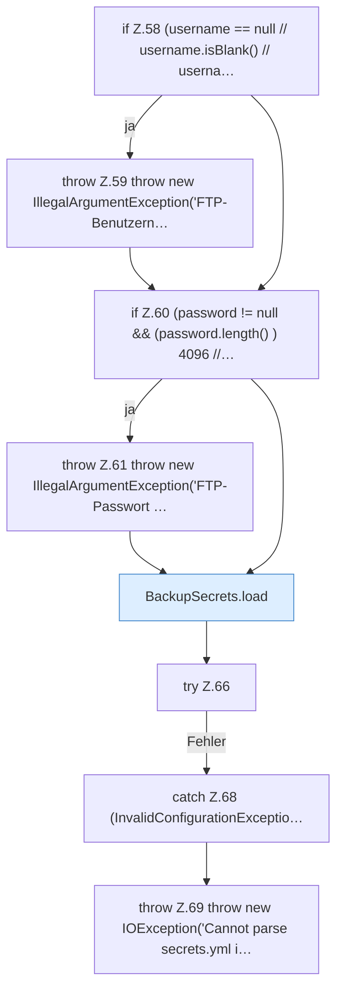

[[00 Start]] › [[Backup]] › [[Backup-Bruecken]] › [[BackupSecrets]] › [[BackupSecrets.saveFtp]] › [[BackupSecrets.saveFtp.Teil1]]

# BackupSecrets.saveFtp.Teil1



```knoten
if Z.58 (username == null // username.isBlank() // userna…
  Zeile 58: prüft `(username == null // username.isBlank() // userna…`.
throw Z.59 throw new IllegalArgumentException('FTP-Benutzern…
  Zeile 59: Abbruch `throw new IllegalArgumentException('FTP-Benutzern…`.
if Z.60 (password != null && (password.length() ) 4096 //…
  Zeile 60: prüft `(password != null && (password.length() ) 4096 //…`.
throw Z.61 throw new IllegalArgumentException('FTP-Passwort …
  Zeile 61: Abbruch `throw new IllegalArgumentException('FTP-Passwort …`.
BackupSecrets.load
  Dieser Teil lädt das. Lädt `load`. Ruft `restrict`.
try Z.66
  Zeile 66: Versuch. Der Fehlerpfad geht in catch.
catch Z.68 (InvalidConfigurationExceptio…
  Zeile 68: fängt (InvalidConfigurationExceptio….
throw Z.69 throw new IOException('Cannot parse secrets.yml i…
  Zeile 69: Abbruch `throw new IOException('Cannot parse secrets.yml i…`.
```

> [!knoten]- Was die Blöcke tun
> - **if Z.58 (username == null // username.isBlank() // userna…**: Zeile 58: prüft `(username == null // username.isBlank() // userna…`.
> - **throw Z.59 throw new IllegalArgumentException('FTP-Benutzern…**: Zeile 59: Abbruch `throw new IllegalArgumentException('FTP-Benutzern…`.
> - **if Z.60 (password != null && (password.length() ) 4096 //…**: Zeile 60: prüft `(password != null && (password.length() ) 4096 //…`.
> - **throw Z.61 throw new IllegalArgumentException('FTP-Passwort …**: Zeile 61: Abbruch `throw new IllegalArgumentException('FTP-Passwort …`.
> - **BackupSecrets.load**: Dieser Teil lädt das. Lädt `load`. Ruft `restrict`.
> - **try Z.66**: Zeile 66: Versuch. Der Fehlerpfad geht in catch.
> - **catch Z.68 (InvalidConfigurationExceptio…**: Zeile 68: fängt (InvalidConfigurationExceptio….
> - **throw Z.69 throw new IOException('Cannot parse secrets.yml i…**: Zeile 69: Abbruch `throw new IOException('Cannot parse secrets.yml i…`.

- Ein weiterer Abschnitt derselben Übersicht.
- Fortsetzung von `BackupSecrets.saveFtp`.
