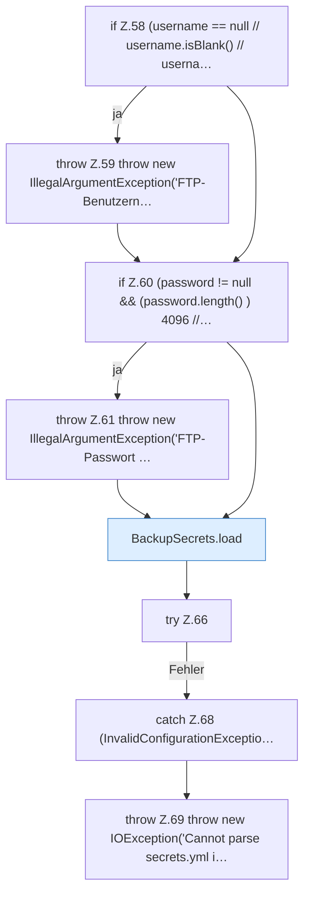

[[00 Start]] › [[Backup]] › [[Backup-Bruecken]] › [[BackupSecrets]] › [[BackupSecrets.saveFtp]] › [[BackupSecrets.saveFtp.Teil1]]

# BackupSecrets.saveFtp.Teil1

- Fortsetzung von `BackupSecrets.saveFtp`, Quellreihenfolge.
