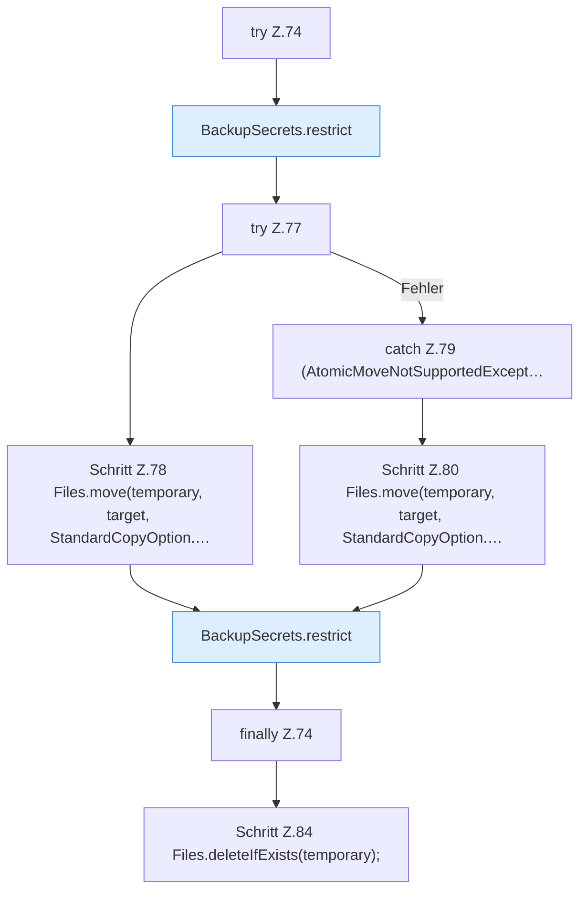

[[00 Start]] › [[Backup]] › [[Backup-Bruecken]] › [[BackupSecrets]] › [[BackupSecrets.saveFtp]] › [[BackupSecrets.saveFtp.Teil2.Z74]]

# BackupSecrets.saveFtp.Teil2.Z74



```knoten
try Z.74
  Zeile 74: Versuch. Der Fehlerpfad geht in catch.
BackupSecrets.restrict
  Dieser Teil macht hier einen einzelnen Schritt. Eine Ebene tiefer steht er genauer. `restrict` in `BackupSecrets.java`.
try Z.77
  Zeile 77: Versuch. Der Fehlerpfad geht in catch.
Schritt Z.78 Files.move(temporary, target, StandardCopyOption.…
  Zeile 78: Dateioperation. `Files.move(temporary, target, StandardCopyOption.…`
catch Z.79 (AtomicMoveNotSupportedExcept…
  Zeile 79: fängt (AtomicMoveNotSupportedExcept….
Schritt Z.80 Files.move(temporary, target, StandardCopyOption.…
  Zeile 80: Dateioperation. `Files.move(temporary, target, StandardCopyOption.…`
finally Z.74
  Läuft danach immer, auch nach einem Fehler.
Schritt Z.84 Files.deleteIfExists(temporary);
  Zeile 84: Dateioperation. `Files.deleteIfExists(temporary);`
```

> [!knoten]- Was die Blöcke tun
> - **try Z.74**: Zeile 74: Versuch. Der Fehlerpfad geht in catch.
> - **BackupSecrets.restrict**: Dieser Teil macht hier einen einzelnen Schritt. Eine Ebene tiefer steht er genauer. `restrict` in `BackupSecrets.java`.
> - **try Z.77**: Zeile 77: Versuch. Der Fehlerpfad geht in catch.
> - **Schritt Z.78 Files.move(temporary, target, StandardCopyOption.…**: Zeile 78: Dateioperation. `Files.move(temporary, target, StandardCopyOption.…`
> - **catch Z.79 (AtomicMoveNotSupportedExcept…**: Zeile 79: fängt (AtomicMoveNotSupportedExcept….
> - **Schritt Z.80 Files.move(temporary, target, StandardCopyOption.…**: Zeile 80: Dateioperation. `Files.move(temporary, target, StandardCopyOption.…`
> - **finally Z.74**: Läuft danach immer, auch nach einem Fehler.
> - **Schritt Z.84 Files.deleteIfExists(temporary);**: Zeile 84: Dateioperation. `Files.deleteIfExists(temporary);`

- Der Ablauf geht in [[Glossar#Zeile|Zeile]] 74 weiter. Eine Ebene tiefer steht er genauer.
- Fortsetzung von `BackupSecrets.saveFtp.Teil2`.
