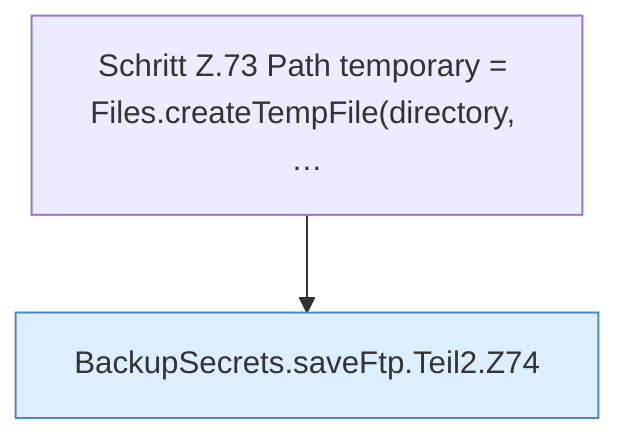

[[00 Start]] › [[Backup]] › [[Backup-Bruecken]] › [[BackupSecrets]] › [[BackupSecrets.saveFtp]] › [[BackupSecrets.saveFtp.Teil2]]

# BackupSecrets.saveFtp.Teil2



```knoten
Schritt Z.73 Path temporary = Files.createTempFile(directory, …
  Zeile 73: Dateioperation. `Path temporary = Files.createTempFile(directory, …`
BackupSecrets.saveFtp.Teil2.Z74
  Fortsetzung des Ablaufs ab Zeile 74.
```

- Fortsetzung von `BackupSecrets.saveFtp`, Quellreihenfolge.
