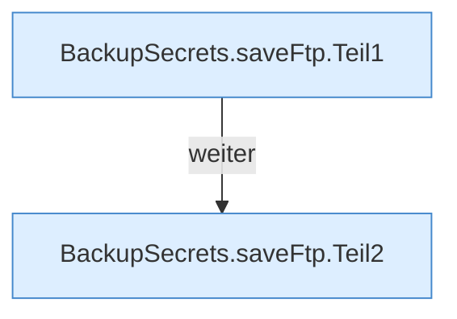

[[00 Start]] › [[Backup]] › [[Backup-Bruecken]] › [[BackupSecrets]] › [[BackupSecrets.saveFtp]]

# BackupSecrets.saveFtp

`BackupSecrets.saveFtp(Path pluginDirectory, String username, String password)` [src/main/java/de/aichele/childlauncher/BackupSecrets.java:57–86](https://github.com/Sciddie/minecraft-serverhoster-plugin/blob/95b02b953b0b4c23673e900e021a7c3c844aa37d/src/main/java/de/aichele/childlauncher/BackupSecrets.java#L57-L86)



```knoten
BackupSecrets.saveFtp.Teil1
  Ein weiterer Abschnitt derselben Übersicht. Abschnitt 1 dieses Ablaufs, in Quellreihenfolge.
BackupSecrets.saveFtp.Teil2
  Ein weiterer Abschnitt derselben Übersicht. Abschnitt 2 dieses Ablaufs, in Quellreihenfolge.
```

> [!knoten]- Was die Blöcke tun
> - **BackupSecrets.saveFtp.Teil1**: Ein weiterer Abschnitt derselben Übersicht. Abschnitt 1 dieses Ablaufs, in Quellreihenfolge.
> - **BackupSecrets.saveFtp.Teil2**: Ein weiterer Abschnitt derselben Übersicht. Abschnitt 2 dieses Ablaufs, in Quellreihenfolge.

- Dieser Teil speichert die Übertragung.
- `saveFtp` in `src/main/java/de/aichele/childlauncher/BackupSecrets.java`
