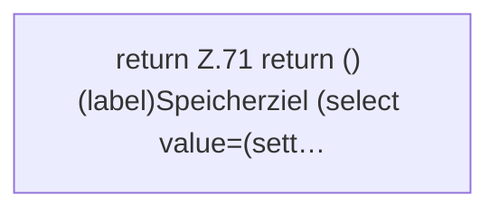

[[00 Start]] › [[Dashboard-UI]] › [[UI-Workflows]] › [[BackupSettings]] › [[BackupSettings.BackupSettings]]

# BackupSettings.BackupSettings

`BackupSettings.BackupSettings({ settings, credentials, options, onSettings, onCredentials, onOptions }: {
  settings: Settings;
  credentials: Credentials;
  options: BackupOptions;
  onSettings: (settings: Settings) => void;
  onCredentials: (credentials: Credentials) => void;
  onOptions: (options: BackupOptions) => void;
})` [ui/src/components/BackupSettings.tsx:63–107](https://github.com/Sciddie/minecraft-serverhoster-plugin/blob/95b02b953b0b4c23673e900e021a7c3c844aa37d/ui/src/components/BackupSettings.tsx#L63-L107)



```knoten
return Z.71 return () (label)Speicherziel (select value=(sett…
  Zeile 71: Rückgabe `return () (label)Speicherziel (select value=(sett…`.
```

> [!knoten]- Was die Blöcke tun
> - **return Z.71 return () (label)Speicherziel (select value=(sett…**: Zeile 71: Rückgabe `return () (label)Speicherziel (select value=(sett…`.

- Dieser Teil sichert die [[Glossar#Einstellungen|Einstellungen]].
- `BackupSettings` in `ui/src/components/BackupSettings.tsx`
