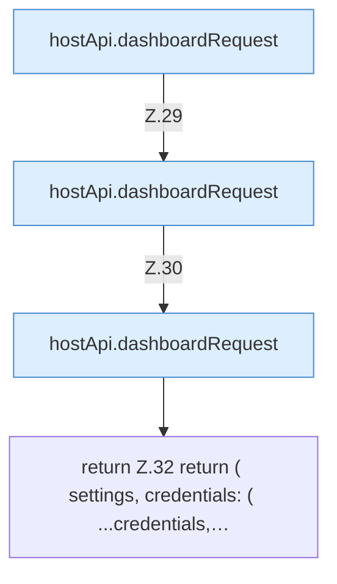

[[00 Start]] › [[Dashboard-UI]] › [[UI-Workflows]] › [[BackupSettings]] › [[BackupSettings.loadBackupSettings]]

# BackupSettings.loadBackupSettings

`BackupSettings.loadBackupSettings()` [ui/src/components/BackupSettings.tsx:26–33](https://github.com/Sciddie/minecraft-serverhoster-plugin/blob/95b02b953b0b4c23673e900e021a7c3c844aa37d/ui/src/components/BackupSettings.tsx#L26-L33)

- `loadBackupSettings` in `ui/src/components/BackupSettings.tsx`
