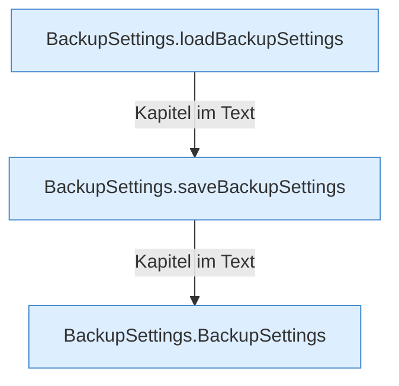

[[00 Start]] › [[Dashboard-UI]] › [[UI-Workflows]] › [[BackupSettings]]

# BackupSettings



```knoten
BackupSettings.loadBackupSettings
  Dieser Teil lädt die [[Glossar#Sicherungskopie|Sicherungskopie]] die [[Glossar#Einstellungen|Einstellungen]]. Im [[Glossar#Quelltext|Quelltext]] heißt das `loadBackupSettings`.
BackupSettings.saveBackupSettings
  Dieser Teil speichert die [[Glossar#Sicherungskopie|Sicherungskopie]] die [[Glossar#Einstellungen|Einstellungen]]. Im [[Glossar#Quelltext|Quelltext]] heißt das `saveBackupSettings`.
BackupSettings.BackupSettings
  Dieser Teil sichert die [[Glossar#Einstellungen|Einstellungen]]. Im [[Glossar#Quelltext|Quelltext]] heißt das `BackupSettings`.
```

> [!knoten]- Was die Blöcke tun
> - **BackupSettings.loadBackupSettings**: Dieser Teil lädt die [[Glossar#Sicherungskopie|Sicherungskopie]] die [[Glossar#Einstellungen|Einstellungen]]. Im [[Glossar#Quelltext|Quelltext]] heißt das `loadBackupSettings`.
> - **BackupSettings.saveBackupSettings**: Dieser Teil speichert die [[Glossar#Sicherungskopie|Sicherungskopie]] die [[Glossar#Einstellungen|Einstellungen]]. Im [[Glossar#Quelltext|Quelltext]] heißt das `saveBackupSettings`.
> - **BackupSettings.BackupSettings**: Dieser Teil sichert die [[Glossar#Einstellungen|Einstellungen]]. Im [[Glossar#Quelltext|Quelltext]] heißt das `BackupSettings`.

- Die [[Glossar#Einstellungen|Einstellungen]], die für jede [[Glossar#Sicherungskopie|Sicherungskopie]] gelten.
