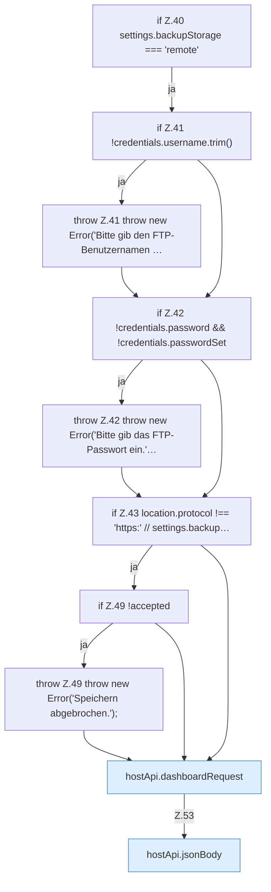

[[00 Start]] › [[Dashboard-UI]] › [[UI-Workflows]] › [[BackupSettings]] › [[BackupSettings.saveBackupSettings]] › [[BackupSettings.saveBackupSettings.Z40]]

# BackupSettings.saveBackupSettings.Z40

- Fortsetzung von `BackupSettings.saveBackupSettings`, Quellreihenfolge.
