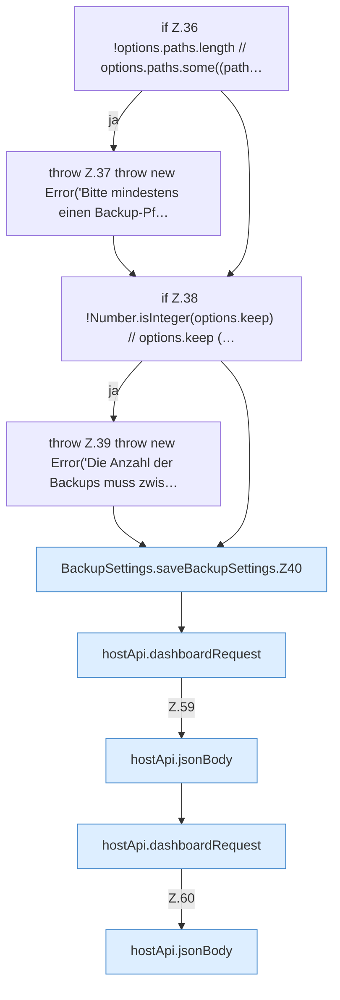

[[00 Start]] › [[Dashboard-UI]] › [[UI-Workflows]] › [[BackupSettings]] › [[BackupSettings.saveBackupSettings]]

# BackupSettings.saveBackupSettings

`BackupSettings.saveBackupSettings(settings: Settings, credentials: Credentials, options: BackupOptions)` [ui/src/components/BackupSettings.tsx:35–61](https://github.com/Sciddie/minecraft-serverhoster-plugin/blob/95b02b953b0b4c23673e900e021a7c3c844aa37d/ui/src/components/BackupSettings.tsx#L35-L61)

- `saveBackupSettings` in `ui/src/components/BackupSettings.tsx`
