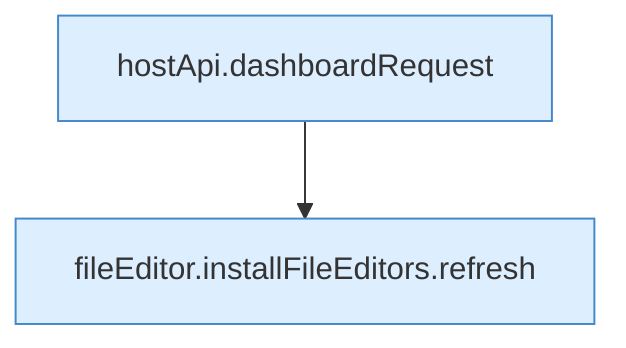

[[00 Start]] › [[Dashboard-UI]] › [[UI-Workflows]] › [[BackupWorkflow]] › [[BackupWorkflow.BackupWorkflow]] › [[BackupWorkflow.BackupWorkflow.Teil1]]

# BackupWorkflow.BackupWorkflow.Teil1

- Fortsetzung von `BackupWorkflow.BackupWorkflow`, Quellreihenfolge.
