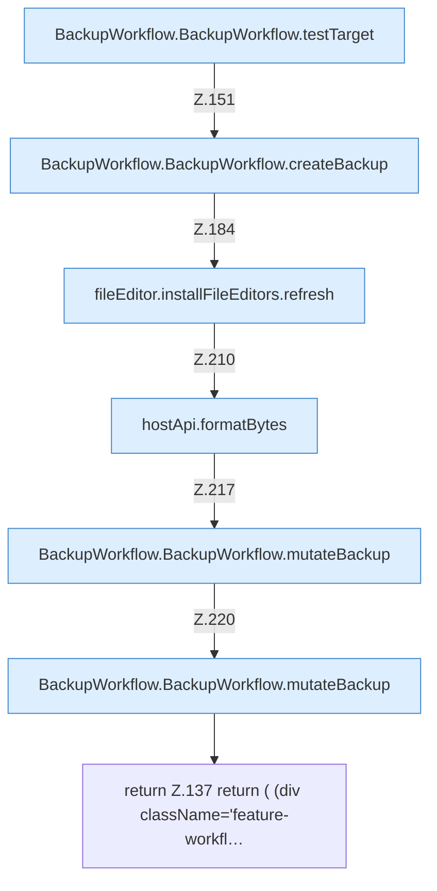

[[00 Start]] › [[Dashboard-UI]] › [[UI-Workflows]] › [[BackupWorkflow]] › [[BackupWorkflow.BackupWorkflow]] › [[BackupWorkflow.BackupWorkflow.Teil2]]

# BackupWorkflow.BackupWorkflow.Teil2



```knoten
BackupWorkflow.BackupWorkflow.testTarget
  Die [[Glossar#Bedienseite|Bedienseite]] prüft hier einen Schritt. Eine Ebene tiefer steht er genauer. Prüft `testTarget`. Ruft `dashboardRequest`.
BackupWorkflow.BackupWorkflow.createBackup
  Die [[Glossar#Bedienseite|Bedienseite]] legt an die [[Glossar#Sicherungskopie|Sicherungskopie]]. Legt an `createBackup`. Ruft `dashboardRequest`, `refresh`.
fileEditor.installFileEditors.refresh
  Die [[Glossar#Bedienseite|Bedienseite]] lädt neu das. Lädt neu `refresh`. Ruft `editorFor`.
hostApi.formatBytes
  Die [[Glossar#Bedienseite|Bedienseite]] macht lesbar die Größe. Formatiert `formatBytes`.
BackupWorkflow.BackupWorkflow.mutateBackup
  Die [[Glossar#Bedienseite|Bedienseite]] sichert das. `mutateBackup` in `BackupWorkflow.tsx`. Ruft `dashboardRequest`, `jsonBody`, `refresh`.
return Z.137 return ( (div className='feature-workfl…
  Zeile 137: Rückgabe `return ( (div className='feature-workfl…`.
```

> [!knoten]- Was die Blöcke tun
> - **BackupWorkflow.BackupWorkflow.testTarget**: Die [[Glossar#Bedienseite|Bedienseite]] prüft hier einen Schritt. Eine Ebene tiefer steht er genauer. Prüft `testTarget`. Ruft `dashboardRequest`.
> - **BackupWorkflow.BackupWorkflow.createBackup**: Die [[Glossar#Bedienseite|Bedienseite]] legt an die [[Glossar#Sicherungskopie|Sicherungskopie]]. Legt an `createBackup`. Ruft `dashboardRequest`, `refresh`.
> - **fileEditor.installFileEditors.refresh**: Die [[Glossar#Bedienseite|Bedienseite]] lädt neu das. Lädt neu `refresh`. Ruft `editorFor`.
> - **hostApi.formatBytes**: Die [[Glossar#Bedienseite|Bedienseite]] macht lesbar die Größe. Formatiert `formatBytes`.
> - **BackupWorkflow.BackupWorkflow.mutateBackup**: Die [[Glossar#Bedienseite|Bedienseite]] sichert das. `mutateBackup` in `BackupWorkflow.tsx`. Ruft `dashboardRequest`, `jsonBody`, `refresh`.
> - **return Z.137 return ( (div className='feature-workfl…**: Zeile 137: Rückgabe `return ( (div className='feature-workfl…`.

- Ein weiterer Abschnitt derselben Übersicht.
- Fortsetzung von `BackupWorkflow.BackupWorkflow`.
