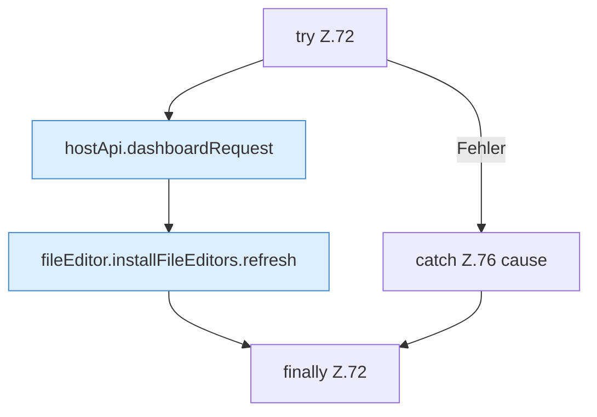

[[00 Start]] › [[Dashboard-UI]] › [[UI-Workflows]] › [[BackupWorkflow]] › [[BackupWorkflow.BackupWorkflow]] › [[BackupWorkflow.BackupWorkflow.createBackup]] › [[BackupWorkflow.BackupWorkflow.createBackup.Z72]]

# BackupWorkflow.BackupWorkflow.createBackup.Z72



```knoten
try Z.72
  Zeile 72: Versuch. Der Fehlerpfad geht in catch.
hostApi.dashboardRequest
  Schickt von der [[Glossar#Bedienseite|Bedienseite]] eine Anfrage an das [[Glossar#Plugin|Plugin]]. `dashboardRequest` in `hostApi.ts`.
fileEditor.installFileEditors.refresh
  Die [[Glossar#Bedienseite|Bedienseite]] lädt neu das. Lädt neu `refresh`. Ruft `editorFor`.
catch Z.76 cause
  Zeile 76: fängt cause.
finally Z.72
  Läuft danach immer, auch nach einem Fehler.
```

> [!knoten]- Was die Blöcke tun
> - **try Z.72**: Zeile 72: Versuch. Der Fehlerpfad geht in catch.
> - **hostApi.dashboardRequest**: Schickt von der [[Glossar#Bedienseite|Bedienseite]] eine Anfrage an das [[Glossar#Plugin|Plugin]]. `dashboardRequest` in `hostApi.ts`.
> - **fileEditor.installFileEditors.refresh**: Die [[Glossar#Bedienseite|Bedienseite]] lädt neu das. Lädt neu `refresh`. Ruft `editorFor`.
> - **catch Z.76 cause**: Zeile 76: fängt cause.
> - **finally Z.72**: Läuft danach immer, auch nach einem Fehler.

- Der Ablauf geht in [[Glossar#Zeile|Zeile]] 72 weiter. Eine Ebene tiefer steht er genauer.
- Fortsetzung von `BackupWorkflow.BackupWorkflow.createBackup`.
