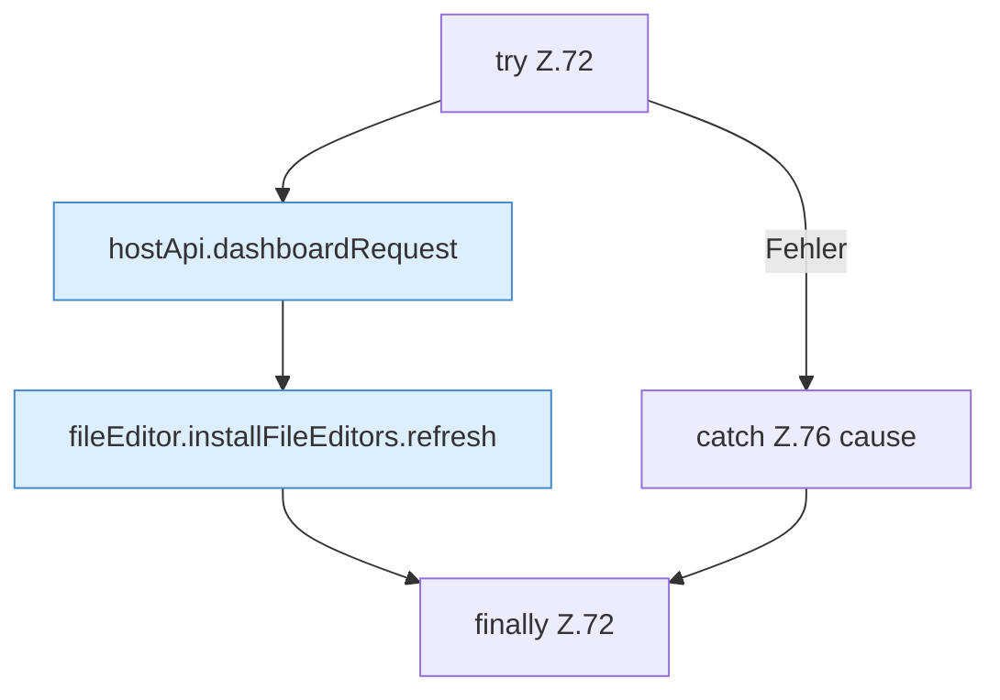

[[00 Start]] › [[Dashboard-UI]] › [[UI-Workflows]] › [[BackupWorkflow]] › [[BackupWorkflow.BackupWorkflow]] › [[BackupWorkflow.BackupWorkflow.createBackup]] › [[BackupWorkflow.BackupWorkflow.createBackup.Z72]]

# BackupWorkflow.BackupWorkflow.createBackup.Z72

- Fortsetzung von `BackupWorkflow.BackupWorkflow.createBackup`, Quellreihenfolge.
