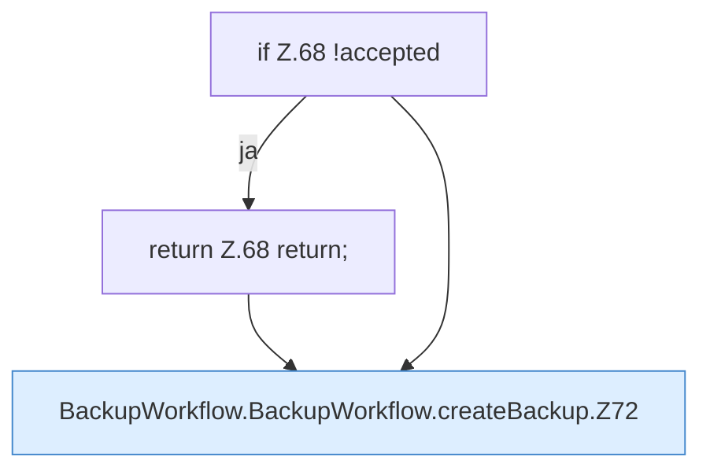

[[00 Start]] › [[Dashboard-UI]] › [[UI-Workflows]] › [[BackupWorkflow]] › [[BackupWorkflow.BackupWorkflow]] › [[BackupWorkflow.BackupWorkflow.createBackup]]

# BackupWorkflow.BackupWorkflow.createBackup

`BackupWorkflow.createBackup()` [ui/src/components/BackupWorkflow.tsx:62–81](https://github.com/Sciddie/minecraft-serverhoster-plugin/blob/95b02b953b0b4c23673e900e021a7c3c844aa37d/ui/src/components/BackupWorkflow.tsx#L62-L81)



```knoten
if Z.68 !accepted
  Zeile 68: prüft `!accepted`.
return Z.68 return;
  Zeile 68: Rückgabe `return;`.
BackupWorkflow.BackupWorkflow.createBackup.Z72
  Fortsetzung des Ablaufs ab Zeile 72.
```

- `createBackup` in `ui/src/components/BackupWorkflow.tsx`
