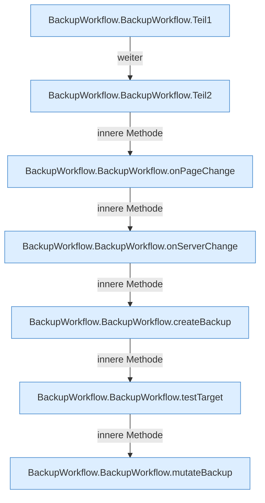

[[00 Start]] › [[Dashboard-UI]] › [[UI-Workflows]] › [[BackupWorkflow]] › [[BackupWorkflow.BackupWorkflow]]

# BackupWorkflow.BackupWorkflow

`BackupWorkflow.BackupWorkflow()` [ui/src/components/BackupWorkflow.tsx:29–232](https://github.com/Sciddie/minecraft-serverhoster-plugin/blob/95b02b953b0b4c23673e900e021a7c3c844aa37d/ui/src/components/BackupWorkflow.tsx#L29-L232)



```knoten
BackupWorkflow.BackupWorkflow.Teil1
  Abschnitt 1 dieses Ablaufs, in Quellreihenfolge.
BackupWorkflow.BackupWorkflow.Teil2
  Abschnitt 2 dieses Ablaufs, in Quellreihenfolge.
BackupWorkflow.BackupWorkflow.onPageChange
  Reagiert `onPageChange`. Ruft `refresh`.
BackupWorkflow.BackupWorkflow.onServerChange
  Reagiert `onServerChange`. Ruft `refresh`.
BackupWorkflow.BackupWorkflow.createBackup
  Legt an `createBackup`. Ruft `dashboardRequest`, `refresh`.
BackupWorkflow.BackupWorkflow.testTarget
  Prüft `testTarget`. Ruft `dashboardRequest`.
BackupWorkflow.BackupWorkflow.mutateBackup
  `mutateBackup` in `BackupWorkflow.tsx`. Ruft `dashboardRequest`, `jsonBody`, `refresh`.
```

- `BackupWorkflow` in `ui/src/components/BackupWorkflow.tsx`
- Befund: Altlast, sicher. BackupWorkflow.tsx:214 server= aus #srv; index.html hat nur CSS #srv
