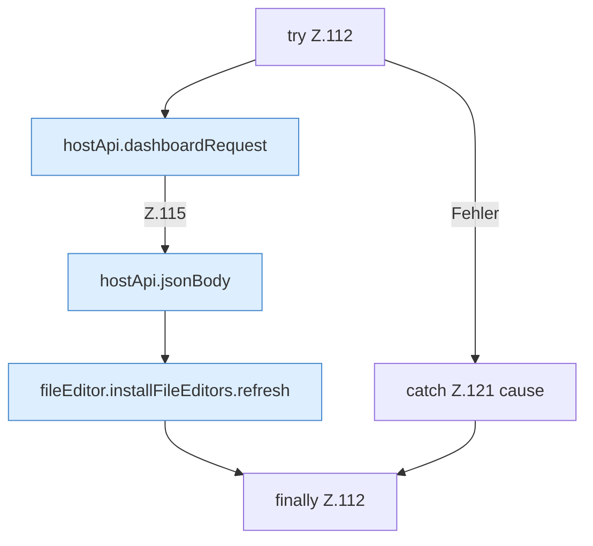

[[00 Start]] › [[Dashboard-UI]] › [[UI-Workflows]] › [[BackupWorkflow]] › [[BackupWorkflow.BackupWorkflow]] › [[BackupWorkflow.BackupWorkflow.mutateBackup]] › [[BackupWorkflow.BackupWorkflow.mutateBackup.Z112]]

# BackupWorkflow.BackupWorkflow.mutateBackup.Z112

- Fortsetzung von `BackupWorkflow.BackupWorkflow.mutateBackup`, Quellreihenfolge.
