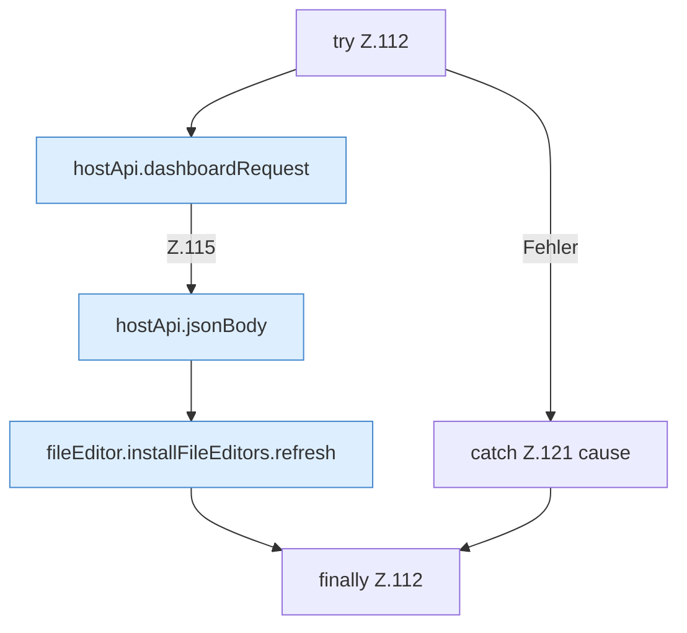

[[00 Start]] › [[Dashboard-UI]] › [[UI-Workflows]] › [[BackupWorkflow]] › [[BackupWorkflow.BackupWorkflow]] › [[BackupWorkflow.BackupWorkflow.mutateBackup]] › [[BackupWorkflow.BackupWorkflow.mutateBackup.Z112]]

# BackupWorkflow.BackupWorkflow.mutateBackup.Z112



```knoten
try Z.112
  Zeile 112: Versuch. Der Fehlerpfad geht in catch.
hostApi.dashboardRequest
  Schickt von der [[Glossar#Bedienseite|Bedienseite]] eine Anfrage an das [[Glossar#Plugin|Plugin]]. `dashboardRequest` in `hostApi.ts`.
hostApi.jsonBody
  Baut den Text, den die [[Glossar#Bedienseite|Bedienseite]] als Auftrag mitschickt. Antwortet mit JSON `jsonBody`.
fileEditor.installFileEditors.refresh
  Die [[Glossar#Bedienseite|Bedienseite]] lädt neu das. Lädt neu `refresh`. Ruft `editorFor`.
catch Z.121 cause
  Zeile 121: fängt cause.
finally Z.112
  Läuft danach immer, auch nach einem Fehler.
```

> [!knoten]- Was die Blöcke tun
> - **try Z.112**: Zeile 112: Versuch. Der Fehlerpfad geht in catch.
> - **hostApi.dashboardRequest**: Schickt von der [[Glossar#Bedienseite|Bedienseite]] eine Anfrage an das [[Glossar#Plugin|Plugin]]. `dashboardRequest` in `hostApi.ts`.
> - **hostApi.jsonBody**: Baut den Text, den die [[Glossar#Bedienseite|Bedienseite]] als Auftrag mitschickt. Antwortet mit JSON `jsonBody`.
> - **fileEditor.installFileEditors.refresh**: Die [[Glossar#Bedienseite|Bedienseite]] lädt neu das. Lädt neu `refresh`. Ruft `editorFor`.
> - **catch Z.121 cause**: Zeile 121: fängt cause.
> - **finally Z.112**: Läuft danach immer, auch nach einem Fehler.

- Der Ablauf geht in [[Glossar#Zeile|Zeile]] 112 weiter. Eine Ebene tiefer steht er genauer.
- Fortsetzung von `BackupWorkflow.BackupWorkflow.mutateBackup`.
