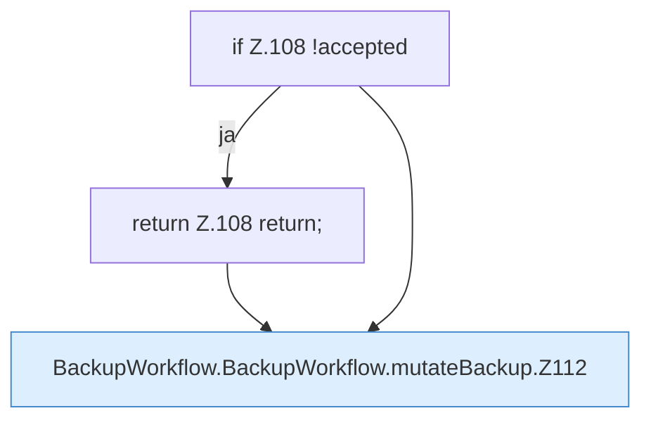

[[00 Start]] › [[Dashboard-UI]] › [[UI-Workflows]] › [[BackupWorkflow]] › [[BackupWorkflow.BackupWorkflow]] › [[BackupWorkflow.BackupWorkflow.mutateBackup]]

# BackupWorkflow.BackupWorkflow.mutateBackup

`BackupWorkflow.mutateBackup(backup: BackupEntry, operation: "restore" | "delete")` [ui/src/components/BackupWorkflow.tsx:98–126](https://github.com/Sciddie/minecraft-serverhoster-plugin/blob/95b02b953b0b4c23673e900e021a7c3c844aa37d/ui/src/components/BackupWorkflow.tsx#L98-L126)

- `mutateBackup` in `ui/src/components/BackupWorkflow.tsx`
