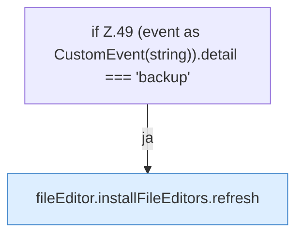

[[00 Start]] › [[Dashboard-UI]] › [[UI-Workflows]] › [[BackupWorkflow]] › [[BackupWorkflow.BackupWorkflow]] › [[BackupWorkflow.BackupWorkflow.onPageChange]]

# BackupWorkflow.BackupWorkflow.onPageChange

`BackupWorkflow.onPageChange(event: Event)` [ui/src/components/BackupWorkflow.tsx:48–50](https://github.com/Sciddie/minecraft-serverhoster-plugin/blob/95b02b953b0b4c23673e900e021a7c3c844aa37d/ui/src/components/BackupWorkflow.tsx#L48-L50)



```knoten
if Z.49 (event as CustomEvent(string)).detail === 'backup'
  Zeile 49: prüft `(event as CustomEvent(string)).detail === 'backup'`.
fileEditor.installFileEditors.refresh
  Lädt neu `refresh`. Ruft `editorFor`.
```

- `onPageChange` in `ui/src/components/BackupWorkflow.tsx`
