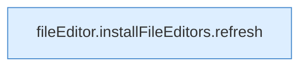

[[00 Start]] › [[Dashboard-UI]] › [[UI-Workflows]] › [[BackupWorkflow]] › [[BackupWorkflow.BackupWorkflow]] › [[BackupWorkflow.BackupWorkflow.onServerChange]]

# BackupWorkflow.BackupWorkflow.onServerChange

`BackupWorkflow.onServerChange()` [ui/src/components/BackupWorkflow.tsx:51–51](https://github.com/Sciddie/minecraft-serverhoster-plugin/blob/95b02b953b0b4c23673e900e021a7c3c844aa37d/ui/src/components/BackupWorkflow.tsx#L51-L51)



```knoten
fileEditor.installFileEditors.refresh
  Lädt neu `refresh`. Ruft `editorFor`.
```

- `onServerChange` in `ui/src/components/BackupWorkflow.tsx`
