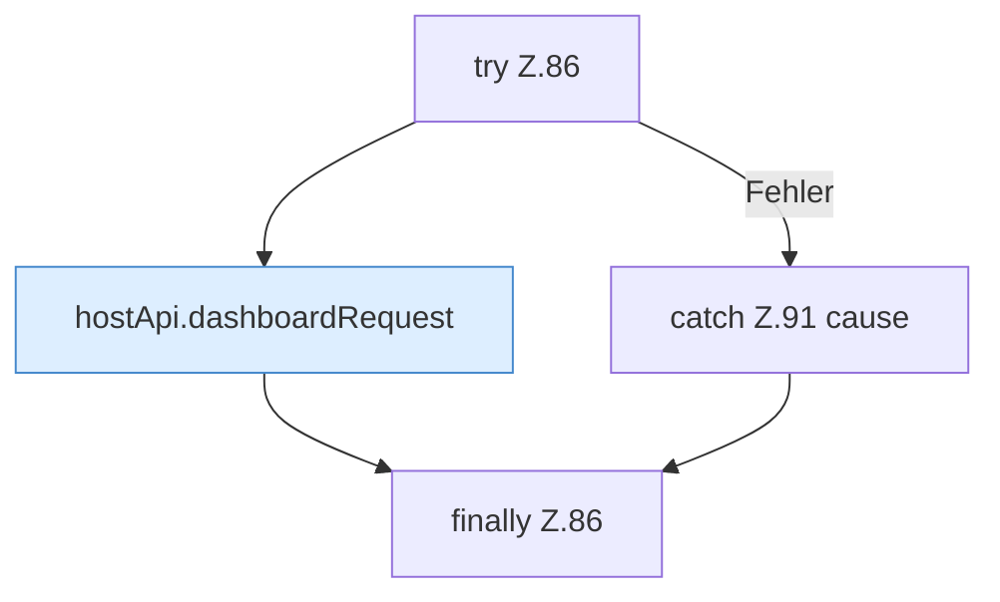

[[00 Start]] › [[Dashboard-UI]] › [[UI-Workflows]] › [[BackupWorkflow]] › [[BackupWorkflow.BackupWorkflow]] › [[BackupWorkflow.BackupWorkflow.testTarget]] › [[BackupWorkflow.BackupWorkflow.testTarget.Z86]]

# BackupWorkflow.BackupWorkflow.testTarget.Z86



```knoten
try Z.86
  Zeile 86: Versuch. Der Fehlerpfad geht in catch.
hostApi.dashboardRequest
  `dashboardRequest` in `hostApi.ts`.
catch Z.91 cause
  Zeile 91: fängt cause.
finally Z.86
  Läuft danach immer, auch nach einem Fehler.
```

- Fortsetzung von `BackupWorkflow.BackupWorkflow.testTarget`, Quellreihenfolge.
