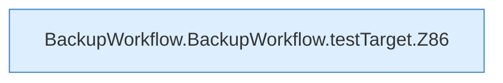

[[00 Start]] › [[Dashboard-UI]] › [[UI-Workflows]] › [[BackupWorkflow]] › [[BackupWorkflow.BackupWorkflow]] › [[BackupWorkflow.BackupWorkflow.testTarget]]

# BackupWorkflow.BackupWorkflow.testTarget

`BackupWorkflow.testTarget()` [ui/src/components/BackupWorkflow.tsx:83–96](https://github.com/Sciddie/minecraft-serverhoster-plugin/blob/95b02b953b0b4c23673e900e021a7c3c844aa37d/ui/src/components/BackupWorkflow.tsx#L83-L96)



```knoten
BackupWorkflow.BackupWorkflow.testTarget.Z86
  Der Ablauf geht in [[Glossar#Zeile|Zeile]] 86 weiter. Eine Ebene tiefer steht er genauer. Fortsetzung des Ablaufs ab Zeile 86.
```

> [!knoten]- Was die Blöcke tun
> - **BackupWorkflow.BackupWorkflow.testTarget.Z86**: Der Ablauf geht in [[Glossar#Zeile|Zeile]] 86 weiter. Eine Ebene tiefer steht er genauer. Fortsetzung des Ablaufs ab Zeile 86.

- Die [[Glossar#Bedienseite|Bedienseite]] prüft hier einen Schritt. Eine Ebene tiefer steht er genauer.
- `testTarget` in `ui/src/components/BackupWorkflow.tsx`
