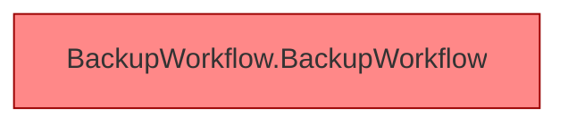

[[00 Start]] › [[Dashboard-UI]] › [[UI-Workflows]] › [[BackupWorkflow]]

# BackupWorkflow



```knoten
BackupWorkflow.BackupWorkflow
  Sichert `BackupWorkflow`. Ruft `dashboardRequest`, `refresh`, `testTarget`. Befund: Altlast (sicher).
```


