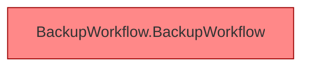

[[00 Start]] › [[Dashboard-UI]] › [[UI-Workflows]] › [[BackupWorkflow]]

# BackupWorkflow



```knoten
BackupWorkflow.BackupWorkflow
  Die [[Glossar#Bedienseite|Bedienseite]] sichert den Ablauf. Im [[Glossar#Quelltext|Quelltext]] heißt das `BackupWorkflow`. Auffällig: ein alter Weg läuft noch mit. Das nennt man [[Glossar#Altlast|Altlast]].
```

> [!knoten]- Was die Blöcke tun
> - **BackupWorkflow.BackupWorkflow**: Die [[Glossar#Bedienseite|Bedienseite]] sichert den Ablauf. Im [[Glossar#Quelltext|Quelltext]] heißt das `BackupWorkflow`. Auffällig: ein alter Weg läuft noch mit. Das nennt man [[Glossar#Altlast|Altlast]].

- Der Ablauf in der [[Glossar#Bedienseite|Bedienseite]] für eine [[Glossar#Sicherungskopie|Sicherungskopie]]: anstoßen, Ziel prüfen, herunterladen.
