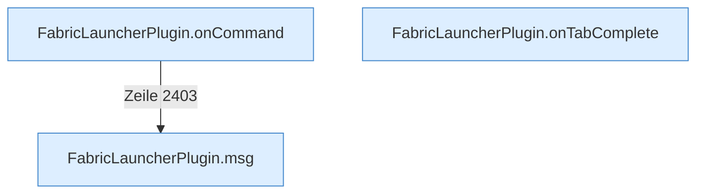

[[00 Start]] › [[Plugin-Kern]] › [[Befehle]]

# Befehle



```knoten
FabricLauncherPlugin.onCommand
  Nimmt den [[Glossar#Befehl|Befehl]] /child entgegen, zum Beispiel Start, [[Glossar#Stopp|Stopp]], Status oder [[Glossar#Sicherungskopie|Sicherungskopie]].
FabricLauncherPlugin.onTabComplete
  Schlägt die nächsten Wörter vor, während jemand /child tippt.
FabricLauncherPlugin.msg
  Schickt eine [[Glossar#Zeile|Zeile]] an den Menschen, der einen [[Glossar#Befehl|Befehl]] getippt hat.
```

> [!knoten] Was die Blöcke tun
> - **FabricLauncherPlugin.onCommand**: Nimmt den [[Glossar#Befehl|Befehl]] /child entgegen, zum Beispiel Start, [[Glossar#Stopp|Stopp]], Status oder [[Glossar#Sicherungskopie|Sicherungskopie]].
> - **FabricLauncherPlugin.onTabComplete**: Schlägt die nächsten Wörter vor, während jemand /child tippt.
> - **FabricLauncherPlugin.msg**: Schickt eine [[Glossar#Zeile|Zeile]] an den Menschen, der einen [[Glossar#Befehl|Befehl]] getippt hat.

- Der [[Glossar#Befehl|Befehl]] /child. Damit startet, stoppt oder prüft man den [[Glossar#Spielserver|Spielserver]]. Nur jemand mit Operator-Recht darf das.
