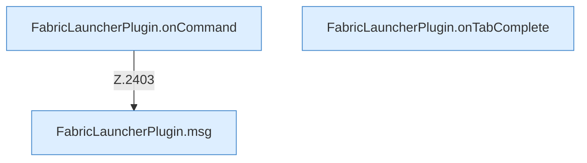

[[00 Start]] › [[Plugin-Kern]] › [[Befehle]]

# Befehle



```knoten
FabricLauncherPlugin.onCommand
  Befehl `/child` auf dem Server-Thread.
FabricLauncherPlugin.onTabComplete
  Reagiert `onTabComplete`. Ruft `crashFiles`.
FabricLauncherPlugin.msg
  Sendet eine Chat-Zeile `msg`.
```

- `plugin.yml` Befehl `child`, Permission `serverhoster.admin` (Default op).
