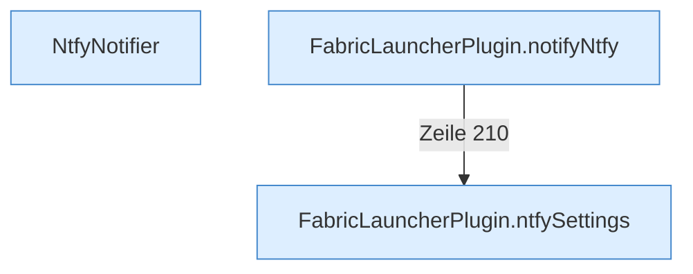

[[00 Start]] › [[Plugin-Kern]] › [[Benachrichtigung]]

# Benachrichtigung



```knoten
NtfyNotifier
  Schickt die Nachricht an den Mitteilungsdienst.
FabricLauncherPlugin.ntfySettings
  Liest die [[Glossar#Einstellungen|Einstellungen]] für den Mitteilungsdienst.
FabricLauncherPlugin.notifyNtfy
  Das [[Glossar#Plugin|Plugin]] meldet den Mitteilungsdienst.
```

> [!knoten] Was die Blöcke tun
> - **NtfyNotifier**: Schickt die Nachricht an den Mitteilungsdienst.
> - **FabricLauncherPlugin.ntfySettings**: Liest die [[Glossar#Einstellungen|Einstellungen]] für den Mitteilungsdienst.
> - **FabricLauncherPlugin.notifyNtfy**: Das [[Glossar#Plugin|Plugin]] meldet den Mitteilungsdienst.

- Schickt eine kurze Nachricht an einen externen Mitteilungsdienst, wenn etwas passiert.
