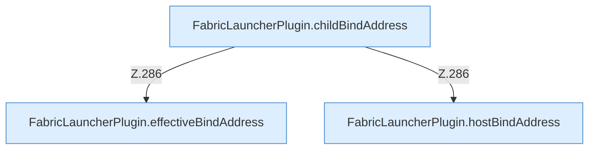

[[00 Start]] › [[Plugin-Kern]] › [[Bind-Adresse]]

# Bind-Adresse



```knoten
FabricLauncherPlugin.hostBindAddress
  Betrifft den Host `hostBindAddress`.
FabricLauncherPlugin.effectiveBindAddress
  Liefert den wirksamen Wert `effectiveBindAddress`.
FabricLauncherPlugin.childBindAddress
  Betrifft den Child `childBindAddress`. Ruft `effectiveBindAddress`, `hostBindAddress`.
```


