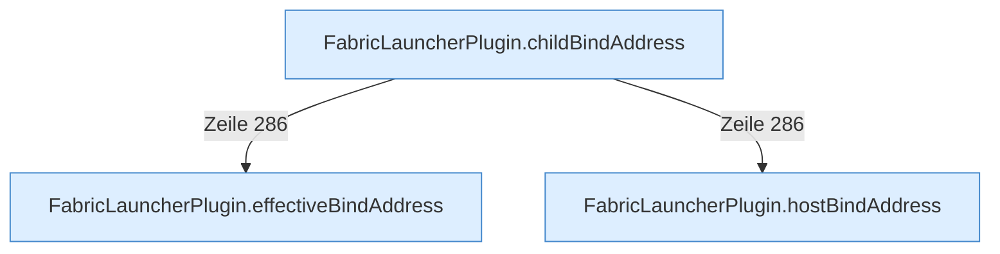

[[00 Start]] › [[Plugin-Kern]] › [[Bind-Adresse]]

# Bind-Adresse



```knoten
FabricLauncherPlugin.hostBindAddress
  Die Adresse, unter der der [[Glossar#Host|Host]] selbst erreichbar sein soll.
FabricLauncherPlugin.effectiveBindAddress
  Die Adresse, die nach allen Ersatzregeln wirklich gilt.
FabricLauncherPlugin.childBindAddress
  Die Adresse, unter der der [[Glossar#Spielserver|Spielserver]] erreichbar sein soll.
```

> [!knoten] Was die Blöcke tun
> - **FabricLauncherPlugin.hostBindAddress**: Die Adresse, unter der der [[Glossar#Host|Host]] selbst erreichbar sein soll.
> - **FabricLauncherPlugin.effectiveBindAddress**: Die Adresse, die nach allen Ersatzregeln wirklich gilt.
> - **FabricLauncherPlugin.childBindAddress**: Die Adresse, unter der der [[Glossar#Spielserver|Spielserver]] erreichbar sein soll.

- Unter welcher Adresse und Türnummer der [[Glossar#Host|Host]], die [[Glossar#Bedienseite|Bedienseite]] und der [[Glossar#Spielserver|Spielserver]] erreichbar sind.
