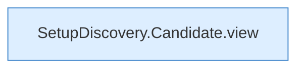

[[00 Start]] › [[Server-Anlage]] › [[Setup-Suche]] › [[SetupDiscovery]] › [[Candidate]]

# Candidate



```knoten
SetupDiscovery.Candidate.view
  Dieser Teil macht hier einen einzelnen Schritt. Eine Ebene tiefer steht er genauer. Liefert die Sicht `view`.
```

> [!knoten]- Was die Blöcke tun
> - **SetupDiscovery.Candidate.view**: Dieser Teil macht hier einen einzelnen Schritt. Eine Ebene tiefer steht er genauer. Liefert die Sicht `view`.

- Ein Treffer dieser Suche: ein Ordner, der eine Anlage sein könnte.
