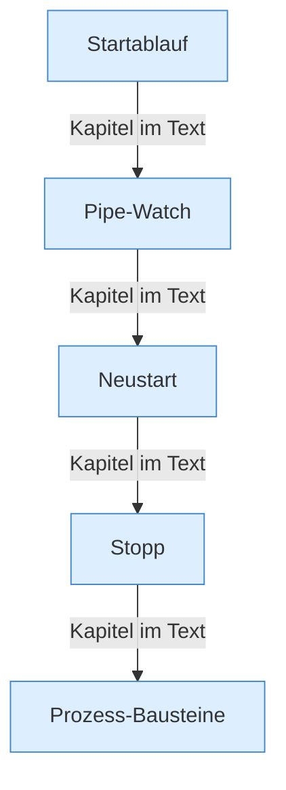
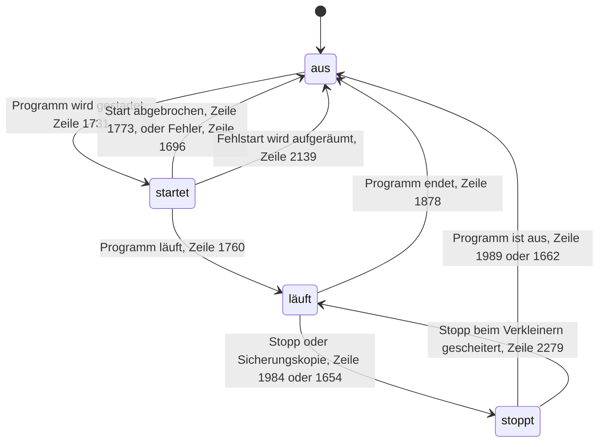

[[00 Start]] › [[Child-Prozess]]

# Child-Prozess



```knoten
Startablauf
  Der [[Glossar#Spielserver|Spielserver]] wird eingeschaltet. Das [[Glossar#Plugin|Plugin]] legt Dateien bereit, startet das Programm und beginnt, die Ausgabe mitzulesen. Scheitert der Start, räumt es wieder auf.
Pipe-Watch
  Das [[Glossar#Plugin|Plugin]] liest mit, was der [[Glossar#Spielserver|Spielserver]] schreibt. Es erkennt [[Glossar#Spieler|Spieler]], die Dauer eines [[Glossar#Spielschritt|Spielschritts]], und ob die [[Glossar#Aufsicht|Aufsicht]] hängen geblieben ist.
Neustart
  Endet der [[Glossar#Spielserver|Spielserver]] unerwartet, wartet das [[Glossar#Plugin|Plugin]] eine [[Glossar#Pause|Pause]] und schaltet ihn wieder ein. Die Pause wird länger, wenn das kurz hintereinander oft passiert.
Stopp
  Der [[Glossar#Spielserver|Spielserver]] wird heruntergefahren. Erst mit der Bitte aufzuhören, dann mit Warten, und nach einer Frist hart. Ein absichtlicher [[Glossar#Stopp|Stopp]] soll nicht gleich wieder starten.
Prozess-Bausteine
  Die Zettel, auf denen Zustand, Programmnummer, [[Glossar#Konsole|Konsole]] und [[Glossar#Pause|Pausen]] stehen. Hier läuft nichts von selbst ab.
```

> [!knoten] Was die Blöcke tun
> - **Startablauf**: Der [[Glossar#Spielserver|Spielserver]] wird eingeschaltet. Das [[Glossar#Plugin|Plugin]] legt Dateien bereit, startet das Programm und beginnt, die Ausgabe mitzulesen. Scheitert der Start, räumt es wieder auf.
> - **Pipe-Watch**: Das [[Glossar#Plugin|Plugin]] liest mit, was der [[Glossar#Spielserver|Spielserver]] schreibt. Es erkennt [[Glossar#Spieler|Spieler]], die Dauer eines [[Glossar#Spielschritt|Spielschritts]], und ob die [[Glossar#Aufsicht|Aufsicht]] hängen geblieben ist.
> - **Neustart**: Endet der [[Glossar#Spielserver|Spielserver]] unerwartet, wartet das [[Glossar#Plugin|Plugin]] eine [[Glossar#Pause|Pause]] und schaltet ihn wieder ein. Die Pause wird länger, wenn das kurz hintereinander oft passiert.
> - **Stopp**: Der [[Glossar#Spielserver|Spielserver]] wird heruntergefahren. Erst mit der Bitte aufzuhören, dann mit Warten, und nach einer Frist hart. Ein absichtlicher [[Glossar#Stopp|Stopp]] soll nicht gleich wieder starten.
> - **Prozess-Bausteine**: Die Zettel, auf denen Zustand, Programmnummer, [[Glossar#Konsole|Konsole]] und [[Glossar#Pause|Pausen]] stehen. Hier läuft nichts von selbst ab.



- Der [[Glossar#Spielserver|Spielserver]] als eigenes Programm: einschalten, Meldungen mitlesen, neu starten, ausschalten. Pfeile mit [[Glossar#Kapitel|Kapitel]] im Text sind keine zeitliche Reihenfolge. Im Zustandsbild heißen die Zustände aus, startet, läuft und stoppt. Im [[Glossar#Quelltext|Quelltext]] heißen sie IDLE, PREPARING, RUNNING und STOPPING.
