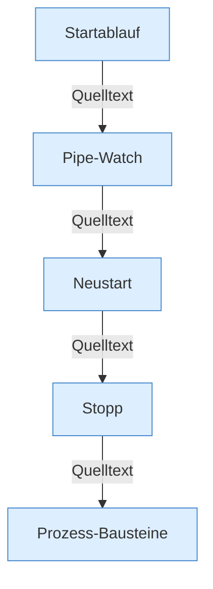
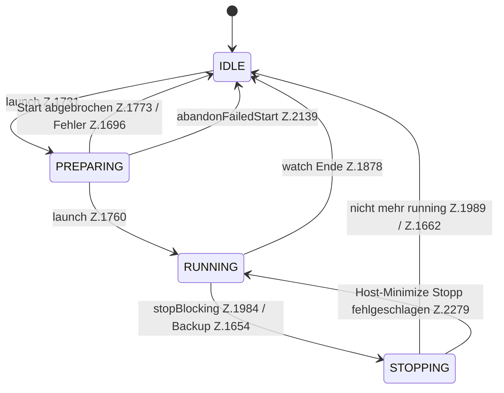

[[00 Start]] › [[Child-Prozess]]

# Child-Prozess



```knoten
Startablauf
  startAsync öffnet den Child, launch schreibt Dateien und startet den Prozess, danach Pipes und Watch; bei Abbruch reapLeftover oder abandonFailedStart.
Pipe-Watch
  Liest stdout und stderr, Tick-Antworten und Spielerliste. tick query frühestens 30 s nach Start, dann höchstens alle 10 s. Sampler jeden Tick, recoverChildSupervision alle 5 s.
Neustart
  scheduleRestart wartet delay mal 1000 ms (initialDelaySeconds Standard 5 s, Deckel maxDelaySeconds Standard 300 s) und ruft restartSingle.
Stopp
  stopBlocking setzt STOPPING. stopProcess ruft ChildStopSequence: Poll 250 ms, Stop erneut alle 5 s, TERM-Gnade 10 s. startupStopTimeoutSeconds Standard 180 s, stopTimeoutSeconds Standard 60 s.
Prozess-Bausteine
  Daten und Hilfsklassen ohne eigenen Ablauf: Slot, Prozess, Stopp, Puffer, Restart, Supervisor.
```



- Phase `IDLE`, `PREPARING`, `RUNNING`, `STOPPING` an `ChildSlot`.
