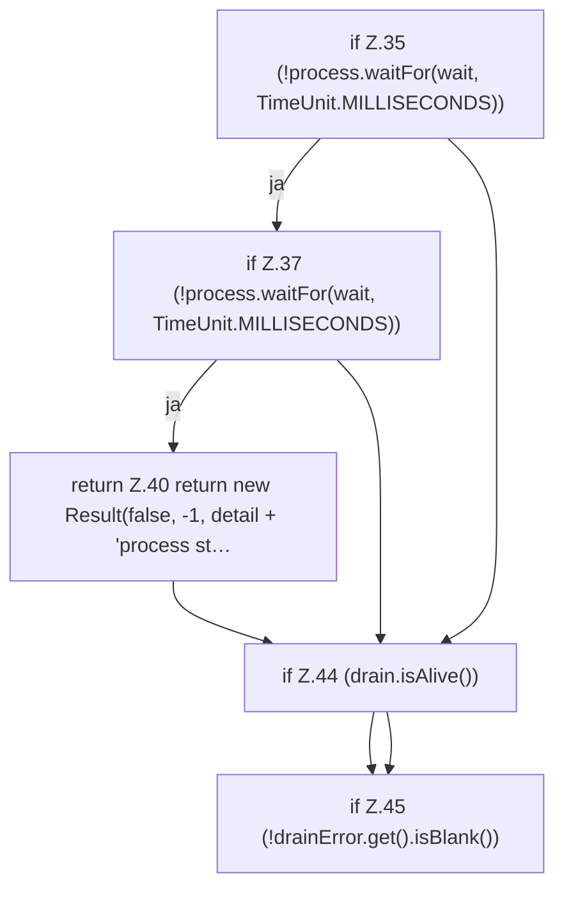

[[00 Start]] › [[Child-Prozess]] › [[Prozess-Bausteine]] › [[ChildLaunchCleanup]] › [[ChildLaunchCleanup.abandon]] › [[ChildLaunchCleanup.abandon.Teil2.Z34.Teil1]]

# ChildLaunchCleanup.abandon.Teil2.Z34.Teil1

- Fortsetzung von `ChildLaunchCleanup.abandon.Teil2.Z34`, Quellreihenfolge.
