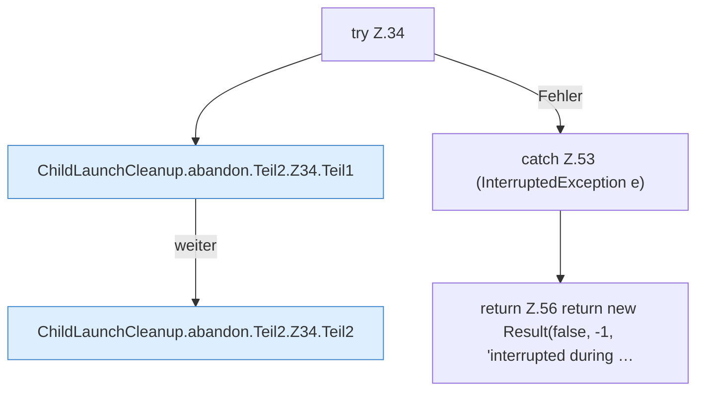

[[00 Start]] › [[Child-Prozess]] › [[Prozess-Bausteine]] › [[ChildLaunchCleanup]] › [[ChildLaunchCleanup.abandon]] › [[ChildLaunchCleanup.abandon.Teil2.Z34]]

# ChildLaunchCleanup.abandon.Teil2.Z34



```knoten
try Z.34
  Zeile 34: Versuch. Der Fehlerpfad geht in catch.
ChildLaunchCleanup.abandon.Teil2.Z34.Teil1
  Ein weiterer Abschnitt derselben Übersicht. Abschnitt 1 dieses Ablaufs, in Quellreihenfolge.
ChildLaunchCleanup.abandon.Teil2.Z34.Teil2
  Ein weiterer Abschnitt derselben Übersicht. Abschnitt 2 dieses Ablaufs, in Quellreihenfolge.
catch Z.53 (InterruptedException e)
  Zeile 53: fängt (InterruptedException e).
return Z.56 return new Result(false, -1, 'interrupted during …
  Zeile 56: Rückgabe `return new Result(false, -1, 'interrupted during …`.
```

> [!knoten]- Was die Blöcke tun
> - **try Z.34**: Zeile 34: Versuch. Der Fehlerpfad geht in catch.
> - **ChildLaunchCleanup.abandon.Teil2.Z34.Teil1**: Ein weiterer Abschnitt derselben Übersicht. Abschnitt 1 dieses Ablaufs, in Quellreihenfolge.
> - **ChildLaunchCleanup.abandon.Teil2.Z34.Teil2**: Ein weiterer Abschnitt derselben Übersicht. Abschnitt 2 dieses Ablaufs, in Quellreihenfolge.
> - **catch Z.53 (InterruptedException e)**: Zeile 53: fängt (InterruptedException e).
> - **return Z.56 return new Result(false, -1, 'interrupted during …**: Zeile 56: Rückgabe `return new Result(false, -1, 'interrupted during …`.

- Der Ablauf geht in [[Glossar#Zeile|Zeile]] 34 weiter. Eine Ebene tiefer steht er genauer.
- Fortsetzung von `ChildLaunchCleanup.abandon.Teil2`.
