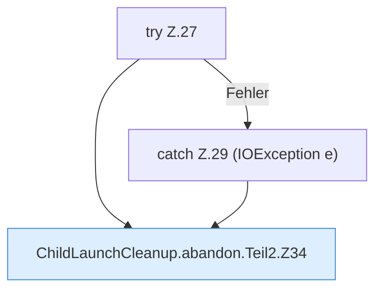

[[00 Start]] › [[Child-Prozess]] › [[Prozess-Bausteine]] › [[ChildLaunchCleanup]] › [[ChildLaunchCleanup.abandon]] › [[ChildLaunchCleanup.abandon.Teil2]]

# ChildLaunchCleanup.abandon.Teil2



```knoten
try Z.27
  Zeile 27: Versuch. Der Fehlerpfad geht in catch.
catch Z.29 (IOException e)
  Zeile 29: fängt (IOException e).
ChildLaunchCleanup.abandon.Teil2.Z34
  Fortsetzung des Ablaufs ab Zeile 34.
```

- Fortsetzung von `ChildLaunchCleanup.abandon`, Quellreihenfolge.
