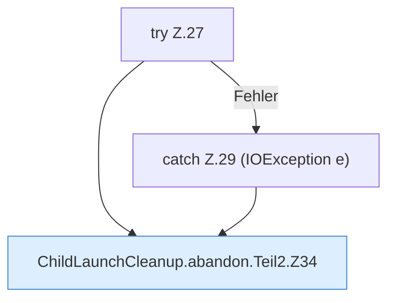

[[00 Start]] › [[Child-Prozess]] › [[Prozess-Bausteine]] › [[ChildLaunchCleanup]] › [[ChildLaunchCleanup.abandon]] › [[ChildLaunchCleanup.abandon.Teil2]]

# ChildLaunchCleanup.abandon.Teil2

- Fortsetzung von `ChildLaunchCleanup.abandon`, Quellreihenfolge.
