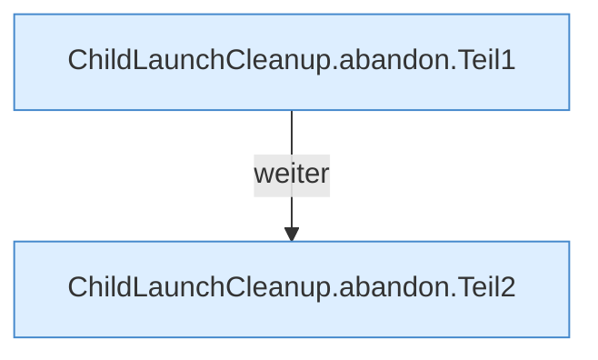

[[00 Start]] › [[Child-Prozess]] › [[Prozess-Bausteine]] › [[ChildLaunchCleanup]] › [[ChildLaunchCleanup.abandon]]

# ChildLaunchCleanup.abandon

`ChildLaunchCleanup.abandon(Process process, long waitMillis)` [src/main/java/de/aichele/childlauncher/ChildLaunchCleanup.java:14–58](https://github.com/Sciddie/minecraft-serverhoster-plugin/blob/95b02b953b0b4c23673e900e021a7c3c844aa37d/src/main/java/de/aichele/childlauncher/ChildLaunchCleanup.java#L14-L58)



```knoten
ChildLaunchCleanup.abandon.Teil1
  Abschnitt 1 dieses Ablaufs, in Quellreihenfolge.
ChildLaunchCleanup.abandon.Teil2
  Abschnitt 2 dieses Ablaufs, in Quellreihenfolge.
```

- `abandon` in `src/main/java/de/aichele/childlauncher/ChildLaunchCleanup.java`
