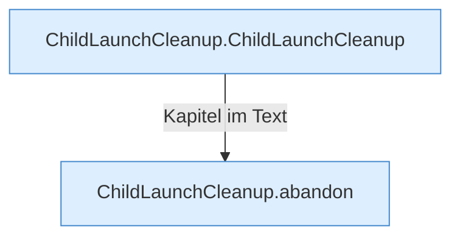

[[00 Start]] › [[Child-Prozess]] › [[Prozess-Bausteine]] › [[ChildLaunchCleanup]]

# ChildLaunchCleanup



```knoten
ChildLaunchCleanup.ChildLaunchCleanup
  Dieser Teil startet das Aufräumen. Im [[Glossar#Quelltext|Quelltext]] heißt das `ChildLaunchCleanup`.
ChildLaunchCleanup.abandon
  Dieser Teil bricht ab das. Im [[Glossar#Quelltext|Quelltext]] heißt das `abandon`.
```

> [!knoten]- Was die Blöcke tun
> - **ChildLaunchCleanup.ChildLaunchCleanup**: Dieser Teil startet das Aufräumen. Im [[Glossar#Quelltext|Quelltext]] heißt das `ChildLaunchCleanup`.
> - **ChildLaunchCleanup.abandon**: Dieser Teil bricht ab das. Im [[Glossar#Quelltext|Quelltext]] heißt das `abandon`.

- Räumt Dateien und übrig gebliebene Programme weg, wenn ein Start nicht geklappt hat.
