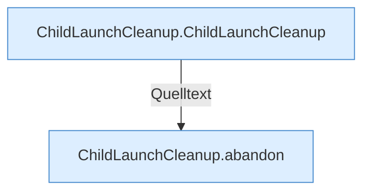

[[00 Start]] › [[Child-Prozess]] › [[Prozess-Bausteine]] › [[ChildLaunchCleanup]]

# ChildLaunchCleanup



```knoten
ChildLaunchCleanup.ChildLaunchCleanup
  Betrifft den Child `ChildLaunchCleanup`.
ChildLaunchCleanup.abandon
  Bricht den fehlgeschlagenen Start ab `abandon`.
```


