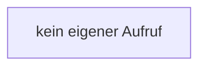

[[00 Start]] › [[Child-Prozess]] › [[Prozess-Bausteine]] › [[ChildProcessRecord]] › [[ChildProcessRecord.Teil1]] › [[ChildProcessRecord.ChildProcessRecord]]

# ChildProcessRecord.ChildProcessRecord

`ChildProcessRecord.ChildProcessRecord()` [src/main/java/de/aichele/childlauncher/ChildProcessRecord.java:42–42](https://github.com/Sciddie/minecraft-serverhoster-plugin/blob/95b02b953b0b4c23673e900e021a7c3c844aa37d/src/main/java/de/aichele/childlauncher/ChildProcessRecord.java#L42-L42)



```knoten
kein eigener Aufruf
  In diesem Stück gibt es keinen weiteren eigenen Aufruf.
```

> [!knoten]- Was die Blöcke tun
> - **kein eigener Aufruf**: In diesem Stück gibt es keinen weiteren eigenen Aufruf.

- Dieser Teil kümmert sich um das laufende Programm den Merkzettel.
- `ChildProcessRecord` in `src/main/java/de/aichele/childlauncher/ChildProcessRecord.java`
