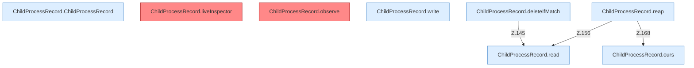

[[00 Start]] › [[Child-Prozess]] › [[Prozess-Bausteine]] › [[ChildProcessRecord]] › [[ChildProcessRecord.Teil1]]

# ChildProcessRecord.Teil1



```knoten
ChildProcessRecord.ChildProcessRecord
  Dieser Teil kümmert sich um das laufende Programm den Merkzettel. Betrifft den Child `ChildProcessRecord`.
ChildProcessRecord.liveInspector
  Dieser Teil macht hier einen einzelnen Schritt. Eine Ebene tiefer steht er genauer. `liveInspector` in `ChildProcessRecord.java`. Ruft `find`, `destroy`, `destroyForcibly`. [[Glossar#Befund|Befund]]: toter Code, wahrscheinlich. src/main/java/de/aichele/childlauncher/ChildProcessRecord.java:44–59 nur von Tests erreicht
ChildProcessRecord.observe
  Dieser Teil macht hier einen einzelnen Schritt. Eine Ebene tiefer steht er genauer. Liest den lebenden [[Glossar#Prozess|Prozess]] `observe`. [[Glossar#Befund|Befund]]: toter Code, wahrscheinlich. src/main/java/de/aichele/childlauncher/ChildProcessRecord.java:61–74 nur von Tests erreicht
ChildProcessRecord.ours
  Dieser Teil macht hier einen einzelnen Schritt. Eine Ebene tiefer steht er genauer. Prüft, ob es der eigene [[Glossar#Prozess|Prozess]] ist `ours`. Ruft `samePath`, `looksLikeJava`, `fileName`.
ChildProcessRecord.write
  Dieser Teil schreibt das. Schreibt `write`. Ruft `safe`.
ChildProcessRecord.read
  Dieser Teil liest das. Liest `read`. Ruft `required`.
ChildProcessRecord.deleteIfMatch
  Dieser Teil löscht hier einen Schritt. Eine Ebene tiefer steht er genauer. Löscht `deleteIfMatch`. Ruft `read`.
ChildProcessRecord.reap
  Dieser Teil räumt weg das. Räumt übrige [[Glossar#Prozess|Prozesse]] ab `reap`. Ruft `read`, `ours`, `waitUntilDead`.
```

> [!knoten]- Was die Blöcke tun
> - **ChildProcessRecord.ChildProcessRecord**: Dieser Teil kümmert sich um das laufende Programm den Merkzettel. Betrifft den Child `ChildProcessRecord`.
> - **ChildProcessRecord.liveInspector**: Dieser Teil macht hier einen einzelnen Schritt. Eine Ebene tiefer steht er genauer. `liveInspector` in `ChildProcessRecord.java`. Ruft `find`, `destroy`, `destroyForcibly`. [[Glossar#Befund|Befund]]: toter Code, wahrscheinlich. src/main/java/de/aichele/childlauncher/ChildProcessRecord.java:44–59 nur von Tests erreicht
> - **ChildProcessRecord.observe**: Dieser Teil macht hier einen einzelnen Schritt. Eine Ebene tiefer steht er genauer. Liest den lebenden [[Glossar#Prozess|Prozess]] `observe`. [[Glossar#Befund|Befund]]: toter Code, wahrscheinlich. src/main/java/de/aichele/childlauncher/ChildProcessRecord.java:61–74 nur von Tests erreicht
> - **ChildProcessRecord.ours**: Dieser Teil macht hier einen einzelnen Schritt. Eine Ebene tiefer steht er genauer. Prüft, ob es der eigene [[Glossar#Prozess|Prozess]] ist `ours`. Ruft `samePath`, `looksLikeJava`, `fileName`.
> - **ChildProcessRecord.write**: Dieser Teil schreibt das. Schreibt `write`. Ruft `safe`.
> - **ChildProcessRecord.read**: Dieser Teil liest das. Liest `read`. Ruft `required`.
> - **ChildProcessRecord.deleteIfMatch**: Dieser Teil löscht hier einen Schritt. Eine Ebene tiefer steht er genauer. Löscht `deleteIfMatch`. Ruft `read`.
> - **ChildProcessRecord.reap**: Dieser Teil räumt weg das. Räumt übrige [[Glossar#Prozess|Prozesse]] ab `reap`. Ruft `read`, `ours`, `waitUntilDead`.

- Ein weiterer Abschnitt derselben Übersicht.
