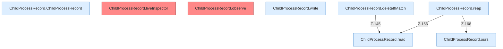

[[00 Start]] › [[Child-Prozess]] › [[Prozess-Bausteine]] › [[ChildProcessRecord]] › [[ChildProcessRecord.Teil1]]

# ChildProcessRecord.Teil1



```knoten
ChildProcessRecord.ChildProcessRecord
  Betrifft den Child `ChildProcessRecord`.
ChildProcessRecord.liveInspector
  `liveInspector` in `ChildProcessRecord.java`. Ruft `find`, `destroy`, `destroyForcibly`. Befund: toter Code (wahrscheinlich).
ChildProcessRecord.observe
  Liest den lebenden Prozess `observe`. Befund: toter Code (wahrscheinlich).
ChildProcessRecord.ours
  Prüft, ob es der eigene Prozess ist `ours`. Ruft `samePath`, `looksLikeJava`, `fileName`.
ChildProcessRecord.write
  Schreibt `write`. Ruft `safe`.
ChildProcessRecord.read
  Liest `read`. Ruft `required`.
ChildProcessRecord.deleteIfMatch
  Löscht `deleteIfMatch`. Ruft `read`.
ChildProcessRecord.reap
  Räumt übrige Prozesse ab `reap`. Ruft `read`, `ours`, `waitUntilDead`.
```


